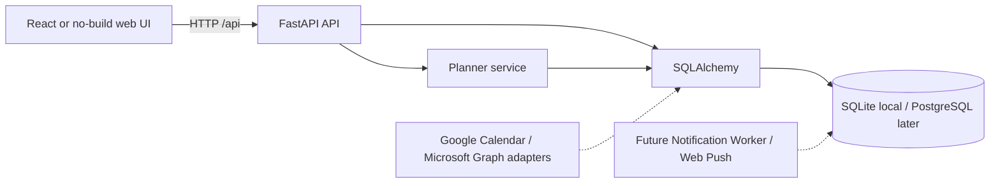

# Day Builder — architecture and engineering decisions

## Layered design



**Why Python + FastAPI?** Simple validation, native Pydantic API schemas, and rich ecosystem for future CP-SAT or ML. React/TypeScript provides flexible future UI. The no-build client is a zero-setup way to exercise the service before Node is available.

**Why SQLite now and PostgreSQL later?** Offline setup is simpler; SQLAlchemy + Alembic provide a migration path. SQLite is **not** the recommended database for multi-user SaaS with concurrent writes.

**Why bounded constraint search rather than OR-Tools today?** A Python-only planner avoids additional solver dependencies in a small offline vertical slice. It satisfies basic windows and conflict detection, but is not globally optimal. At larger scales, replace the engine with OR-Tools CP-SAT and create a ranked objective for missed required tasks, preference deviation, fragmentation, idle time and changes vs the previous plan.

## Current local data model

- `preferences`: a single row (id=1) with time zone, sleep/wake, meal definitions.
- `activities`: task templates with recurrence, priority, duration, required flag and windows.
- `calendar_events`: fixed events with local wall-clock date/time, source=manual.
- `day_plans`: generated plan per date with warnings.
- `plan_blocks`: fixed event / meal / activity, status and explanation.

OAuth calendar_connections and oauth_attempts tables added in v0.2, with external event keys. Current schema is **single-user only**. In a multiuser revision, `user_id` must be added to every user-scoped table, authenticated principals must be enforced on every route, and token isolation must be applied before enabling any public port.

## Calendar integration design (implemented as manual full-window sync in v0.2)

- OAuth 2.0 authorization-code with PKCE where appropriate; keep refresh/access tokens encrypted on server, never in browser `localStorage`.
- Google Calendar API: prefer minimum read-only scope needed, handle full and incremental synchronization with `syncToken`, pagination and invalid/expired token resync (HTTP 410).
- Microsoft Graph: enumerate enabled Outlook/Microsoft 365 calendars; use per-calendar calendarView endpoints / delta tracking; Teams meetings are calendar events from Microsoft 365, **not a separate hypothetical Teams calendar API**.
- Store provider account ID, calendar ID, provider event ID, original time zone, all-day / busy transparency and last sync cursor.
- De-duplicate events using provider+account+calendar+event ID; do not de-duplicate only by title/time because two separate meetings may share the same title and start.
- Recurrences and exceptions: expand provider occurrences for the requested date; a cancellation must remove an old stored slot.
- User opt-in and reauthorization for scope expansion; work tenant admin consent requirements may vary.
- All external calendar integrations remain read-only initially.

## Time zone / daylight saving strategy for the next version

Current MVP uses local same-day wall-clock minutes. `Europe/Kyiv` is configured by default, but per-event UTC conversion, travel between time zones, DST 23h/25h days and spans across midnight are **not supported**. Recommended production data format: UTC start/end instants + provider IANA timezone + original local date; use `zoneinfo` and test DST folds/gaps.

## Planned API contract

Current endpoints:

```
GET    /api/health
GET    /api/settings
PUT    /api/settings
GET    /api/activities
POST   /api/activities
PUT    /api/activities/{id}
DELETE /api/activities/{id}
GET    /api/events?on_date=YYYY-MM-DD
POST   /api/events
DELETE /api/events/{id}
GET    /api/plans/{date}
POST   /api/plans/generate
PATCH  /api/plans/blocks/{id}
GET    /docs
```

Future endpoints must use authenticated user context, pagination/rate limiting, optimistic locking/versioning of plan records, idempotent webhook handling, and observable background jobs.

## Release blocking items before any public SaaS deployment

Authentication; authorization; data encryption and key rotation; token consent; retention and deletion; threat modelling; multi-tenant isolation tests; HTTPS; hosting logs that avoid event titles/tokens; backup/restore; dependency auditing; legal privacy/GDPR review; provider OAuth verification; CI and production monitoring. Local-first code is NOT intended to be exposed publicly.

## v0.2 calendar integration decisions

- Endpoints: `/api/integrations` plus per-provider `/start`, `/callback`, `/sync`, `DELETE` disconnect.
- Single provider connection per local installation. Google Calendar API `/users/me/calendarList` + per-calendar `/events` `singleEvents=true`; Microsoft Graph `/me/calendars` + `/me/calendars/{id}/calendarView` with `Prefer: outlook.timezone="UTC"`. All pages retrieved before local replacement.
- OAuth flow: Authorization Code + PKCE + same-site HTTP-only cookie + hashed state + 10-minute expiry. Vault uses Fernet, local disk key in `.secrets`, plaintext never emitted in API.
- Two additional tables: `calendar_connections` encrypted access/refresh token, status, last synchronization; `oauth_attempts` state and encrypted code verifier. `calendar_events.external_key` hashed provider+calendar+event+day used to prevent duplicates.
- Data is fetched and replaced for an explicit 17-day inclusive local window. Network/provider failure does not clear the previously imported events.
- No automatic change detection, no webhook, no server-side per-user auth, no account isolation. Do **not** expose to the public internet.


## v0.3: локальна синхронізація

Після застосування міграції `0003` DayPlan має `calendar_stale`. Модуль `integrations/sync_service.py` використовується ручними маршрутами та локальним фоновим worker. При синхронізації оновлюється обраний діапазон (від -2 до +14 днів), тільки після повного отримання сторінок. Диф за external_key/title/start/end визначає дні зі змінами, збережені плани цих днів стають застарілими; автоматичне перепланування не виконується. Нова синхронізація без змін не оновлює event ids.

`integrations/background.py` працює як asyncio-задача в життєвому циклі FastAPI тільки за `DAYBUILDER_AUTO_SYNC=1`; не виживає після зупинення процесу і не є production scheduling системою. Використовуйте один uvicorn worker для single-user MVP, інакше декілька процесів можуть дублювати запити. Для SaaS потрібна централізована черга/планувальник, lock, retry/backoff, rate-limit та контроль користувачів.
